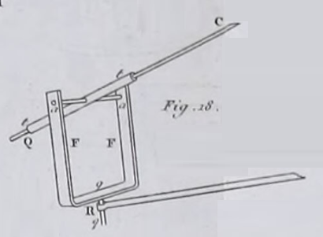

[Traité de physique expérimentale et mathématique - Volume 3 / Par Jean-Baptiste Biot, 1816](https://wellcomecollection.org/works/kz3s48bg/items?canvas=195&manifest=2&query=gravesande)

_Spiegazione dei miglioramenti apportati da Charles all'eliostato di Gravesande, per rendere più semplice e veloce la calibrazioe: il "posizionatore", anzichè essere un oggetto separato, è un tutt'uno col piedistallo dell'orologio, rispetto al quale è vincolato a scorrere e ruotare secondo regole ben precise che permettono di soddisfare automaticamente i complicati vincoli di distanze necessari al funzionamento del meccanismo.
Nota: le lettere e figure usate nel testo non sembrano corrispondere a quelle presenti nella tavola indicata nel testo stesso._

Gravesande originale:

   

Gravesande modificato da Charles:

  

[...]

184

Supporrò inizialmente che il supporto dello specchio e l'orologio siano 

185

assolutamente indipendenti l'uno dall'altro e possano essere spostati separatamente. Era così nello strumento di S'gravesande. M. Charles ha modificato questa disposizione e ha reso il posizionamento dell'apparecchio molto più comodo; vedremo tra poco in cosa consiste questa modifica, esaminando dapprima il caso più semplice.   Si comincia a dare allo stilo $C'P'$ portato dall'orologio la lunghezza $R \tan (d)$ in base al giorno dell'osservazione, con **R**  raggio della lancetta dell'orologio e **d** la declinazione del sole, che si prende nell'annuario o nella conoscenza dei tempi. Se si considerano le declinazioni come positive quando il sole è da un lato dell'equatore, per esempio verso il polo boreale, bisogna considerarle negative quando si trova dall'altro lato di questo piano. Ma poiché non si può fare la lunghezza dello stilo minore di zero, non si fa partire la sua origine dal quadrante stesso; la si conta a partire da una certa altezza arbitraria **A** al di sopra di questo piano. Allora bisogna elevare anch'esso della stessa quantità **A** l'asse del tubo **tt** (fig. 21), 

che porta la coda dello specchio. [Che c'entra la figura 21?!? Semmai la 18]

In questo modo, il piano ideale che abbiamo designato con **E'Q'** è parallelo al quadrante, e l'altezza totale dello stilo, contata dal quadrante stesso, è $A + R \tan (d)$; essa può calcolarsi e costruirsi in tutte le declinazioni del sole, purché **A** superi il valore negativo massimo di $R \tan (d)$.   Fatto ciò, si pone il supporto dello specchio nel luogo in cui si vuole che lo specchio sia collocato. Ma  al posto dello specchio si mette il *posizionatore*, rappresentato anch'esso nella fig. 21. 

Questo apparecchio è composto da un righello **YZ** connesso a un supporto articolato **$VX**, che si adatta precisamente sul supporto dello specchio in modo tale che il punto **X** corrisponda esattamente al centro **C** della superficie riflettente. Questo supporto può ruotare intorno al supporto dello specchio in senso orizzontale, e il righello **YZ** ha un movimento verticale di rotazione intorno al punto **X**, in modo da poterlo puntare in qualunque direzione e con qualuneuq inclinazione. Lo si gira nella direzione costante

186

che si vuol dare al raggio riflesso; e siccome il braccio **XZ** è composto da due righelli mobili l'uno nell'altro, gli si dà precisamente una lunghezza uguale alla distanza $\frac{R}{\cos (d)}$ che deve esistere quel giorno tra l'estremità **P'** dello stilo **C'P'** dell'orologio e il punto **C** o **X** nel quale la coda interseca la superficie dello specchio.  Una volta stabilita in questo modo la posizione dell'estremità **Z** del *posizionatore* nello spazio, non resta più che farla coincidere con la sommità **P'** dello stilo. A tal fine, si colloca l'orologio accanto al *posizionatore*, e per quanto possibile, in modo che poggi su uno stesso piano orizzontale. Poi, se la distanza dell'equatore allo zenit nel luogo dell'osservazione è $\Delta$, si dà al piano del quadrante un'inclinazione $\Delta$ rispetto alla verticale; dopodiché si dirige nel piano del meridiano la linea di fede **FF** che l'artista deve aver tracciato sul supporto dell'orologio, parallelamente alla linea del quadrante che va dalle $12^h$ alle $6^h$. Fatta questa operazione, l'orologio è orientato, e il piano del quadrante è parallelo all'equatore. 

A questo punto si fa muovere l'orologio parallelamente a se stesso, in modo da avvicinare l'estremità **P'** dello stilo all'estremità **Z** del *posizionatore*, avendo ben cura che la linea di fede **FF** resti sempre parallela al meridiano del luogo. Quando questi due punti coincidono, tutte le condizioni di distanza sono soddisfatte; allora si toglie il *posizionatore*, e si sostituisce con lo specchio. Si imposta l'orologio sull'ora attuale, girando la lancetta in modo che l'estremità dell'ombra dello stilo passi in mezzo al tubo **tt**; il che si verifica girando questo tubo finché il raggio solare passa attraverso, e ricevendo su di una carta l'immagine del foro in mezzo al quale la punta dello stilo deve apparire come un punto nero. Quando questa condizione è soddisfatta, si toglie il pezzo **FF** destinato a guidare la coda dello specchio; si passa questa coda nel tubo **tt**, e si ricolloca la coda del pezzo **FF** all'estremità della lancetta dell'orologio, nella cavità che gli è destinata. Se si sono ben osservate tutte queste condizioni, l'orologio guiderà lo specchio in modo che il raggio riflesso conserverà sensibilmente la stessa direzione durante tutta la giornata.

187

Tutta la difficoltà dell'operazione consiste, come si vede, nel tentativo per tentoni che bisogna compiere per portare l'estremità **Z** del braccio del positore a contatto con l'estremità **P'** dello stile: è questo tentativo che il signor Charles ha evitato nel modo più semplice, fig. 22. 

Il piedistallo comune del positore e dello specchio è invariabilmente unito al piedistallo dell'orologio da un braccio orizzontale **L" C"**, che può ruotare orizzontalmente attorno al punto di giunzione **C"**. Il pezzo **C" L** che appartiene al piedistallo dell'orologio è parallelo alla linea meridiana, ed inoltre è mobile nel senso della sua lunghezza, in modo da poter far variare la distanza del punto **C"** dalla verticale **L O**, che passa per il centro del quadrante. Si determina ogni giorno questa distanza tramite la condizione che l'estremità **P'** dello stile sia verticale al di sopra di **C"**, quando l'orologio è collocato su un piano orizzontale; a tal fine ci si serve di una divisione tracciata su **C" L**. Il pezzo **C" L"** può anche allungarsi o accorciarsi, e il supporto del positore può sollevarsi e abbassarsi.

Ciò posto, quando si è orientato l'orologio, si comincia a operare come se il raggio riflesso dovesse essere diretto nel piano del meridiano che passa per lo stile. 

Si gira quindi il braccio **L" C"** nella direzione di questo piano, fig. 23, vale a dire lo si porta sul prolungamento di **C" L**; poi, dopo aver dato al braccio **X Z** del positore la lunghezza che deve avere quel giorno, e l'inclinazione rispetto all'orizzonte che si vuole assegnare al raggio riflesso, si allunga o si accorcia **C" L"** finché l'estremità **Z** del positore si trova nella stessa verticale del vertice **P'** dello stile; dopodiché, è sufficiente elevare o abbassare il supporto del positore affinché il punto **Z** venga a coincidere completamente con il punto **P'**. Tale sarebbe dunque la posizione del piedistallo dello specchio e di quella dell'orologio, se il raggio riflesso dovesse essere directed nel meridiano. Ma se lo si vuole dirigere in qualsiasi altro piano verticale, senza cambiarne l'inclinazione, non vi è che da far ruotare il braccio **L" C"** attorno al punto **C"**, fig. 22, in modo da portarlo in tale piano; poiché in questo movimento, il braccio **X Z** del positore descrive una superficie conica circolare attorno al vertice **P'** dello stile, e la sua estremità **Z** non abbandona mai questo punto. Di conseguenza, le 

188 

condizioni di coincidenza che regolano la coda dello specchio e che rendono immobile il raggio riflesso, sono sempre soddisfatte.

Si possono anche determinare ogni giorno le lunghezze dei bracci **C" L**, **C" L"** tramite il calcolo, supponendo che si sia tracciata su ciascuno di essi una divisione in parti uguali. Cominciamo dal primo. Abbiamo chiamato **A** la distanza del quadrante dal vertice dello stile all'epoca degli equinozi. Supponiamo che l'artefice proietti questo vertice sul braccio **C" L**, e vi segni lo zero della divisione di questo braccio. Ora, per qualsiasi altro giorno determinato, l'incremento di lunghezza dello stile sarà $$R * \tan(d)$$, essendo **R** il raggio dell'orologio. Ora, essendo questo stile perpendicolare al piano del quadrante che rappresenta l'equatore, esso è parallelo all'asse di rotazione diurna del cielo. Di conseguenza, l'angolo che esso forma con l'orizzonte è precisamente uguale alla distanza dell'equatore dal zenith, che abbiamo chiamato **$\Delta$**. Così la variazione di lunghezza dello stile essendo $$R * \tan(d)$$, quella della sua proiezione orizzontale sarà $$R * \tan(d) \cos(\Delta)$$. Tale è dunque la quantità di cui bisogna far avanzare il punto **C"** sulla divisione orizzontale **C" L** per adattarla al giorno dato.

Si avrà un risultato simile per la divisione **C" L"**, che è ugualmente la proiezione orizzontale del braccio **X Z**; ma per calcolarla, occorrerà fissare l'inclinazione $$i$$ del raggio riflesso sull'orizzonte. Allora essendo **X Z** pari a $$\frac{R}{\cos(d)}$$, la sua proiezione **C" L"** sarà $$\frac{R \cos(i)}{\cos(d)}$$, o, ciò che equivale allo stesso,

$$R + 2 R \frac{\sin \frac{1}{2}(d + i) \sin \frac{1}{2}(d - i)}{\cos d}$$

Mettiamo lo zero della divisione a una distanza **R** dal centro di rotazione **C"**; allora il piede **L"** del supporto dovrà essere collocato sullo zero, quando $$d$$ diventerà uguale ad $$i$$; per esempio, all'epoca degli equinozi, se il raggio riflesso deve essere orizzontale; dopodiché il secondo termine della formula esprimerà le variazioni di lunghezza che bisogna dare a **C" L"** per ogni giorno dell'anno.

189

si alzi e si abbassi contemporaneamente ad esso. Ora, poiché lo stile è inclinato sull'orizzonte dell'angolo **$\Delta$**, bisogna, per decomporre nel senso verticale le variazioni **C' P'** della sua lunghezza, moltiplicarle per $$\sin \Delta$$; il che dà per il loro valore $$R \tan(d) \sin(\Delta)$$; e si vede che esse saranno successivamente positive e negative, a seconda della situazione del sole, da un lato o dall'altro dell'equatore. Questa espressione variabile si aggiunge all'altezza costante **C' \zeta**, che chiameremo **B**, e ne risulta $$B + R tan(d) \sin(\Delta)$$, per l'altezza verticale dell'estremità **Z** del positore al di sopra del braccio orizzontale **L" C"**. Se vi si aggiunge $$\frac{R \sin(i)}{\cos (d)}$$, proiezione del braccio **X Z** del positore sulla verticale, la somma esprimerà l'altezza del centro **X** dello specchio al di sopra dell'orizzontale **C" L"**. L'espressione di questa altezza sarà dunque

$$B + \frac{R (\sin(d)\sin(\Delta)+ \sin(i))}{\cos(d)}$$.

Questo sarà l'oggetto di una terza divisione che sarà verticale e adattata al piedistallo dello specchio. Lo zero di questa dovrà essere collocato all'altezza **B**, che è quella del centro dello specchio, negli equinozi, quando il raggio riflesso deve essere orizzontale; poiché allora $$i$$ e $$d$$ sono nulli.

Per mezzo di queste tre divisioni, si potrà fare a meno ogni giorno del positore, e vi si supplirà con il calcolo. Se il raggio riflesso dovesse essere diretto nel meridiano, i due bracci **C" L"**, **C" L** avrebbero la stessa direzione, e si potrebbero esprimere le due variazioni orizzontali con una sola formula, di conseguenza valutarle tramite una sola divisione. Ma ciò non avrebbe più luogo in qualsiasi altro piano; e allora le tre divisioni sono indispensabili.

Infine occorrerà anche che l'asta dello stile sia graduata, e possa rientrare nel quadrante o uscirne, affinché gli si possa dare ogni giorno la lunghezza conveniente $$R tan(d)$$ a partire dal punto **C'**. Ma questa condizione è necessaria solo in quanto si voglia che lo strumento si metta da sé all'ora. Poiché vi si potrebbe supplire, sebbene in modo più scomodo, regolando le lancette dell'orologio su un cronometro.
